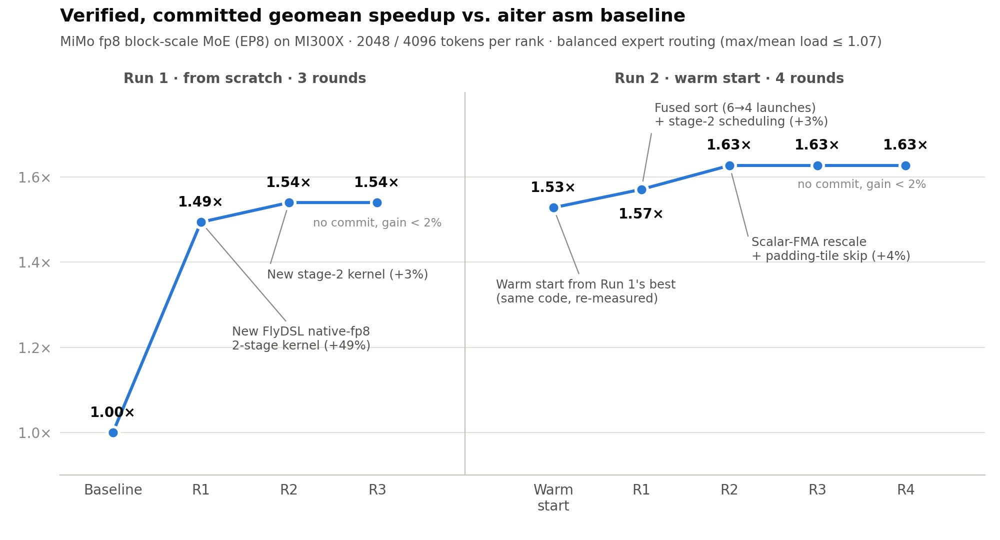
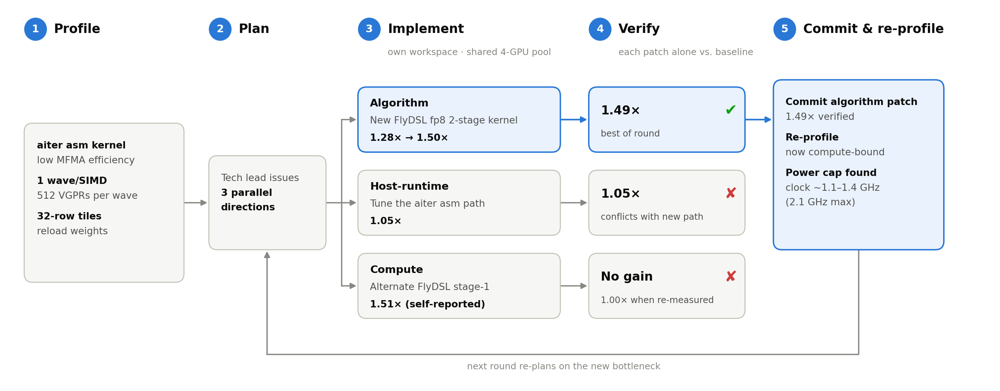

# GEAK slides — MiMo fp8 MoE on MI300X (2 pages)

Assets: `speedup_progression.png` (chart, regenerate with `python3 src/make_chart.py speedup_progression.png`) · `round1_process.png` (flow, regenerate with `python3 src/make_flow.py round1_process.png`)

---

## Slide 1 — Why GEAK: 1.63× on a production MoE kernel, no human-written code

**Layout:** left = "Why GEAK" bullets · right = chart + results table

### Why GEAK

- **Autonomous loop** — profile → plan → implement → verify → merge → re-profile; no hardware expertise required.
- **Parallel specialists** — 2–3 directions per round, one specialist engineer each direction(algorithm / memory / compute / host), sharing a 4-GPU pool with isolated workspaces.
- **Trustworthy gains** — an independent verifier re-measures every patch against one frozen baseline.
- **Profile-driven** — HW counters + ISA every round; tracks bottleneck shifts and re-bases the ceiling on the measured (power-capped) clock.
- **Auditable** — every patch, report, and agent transcript is kept.

### Result

| | Baseline (aiter asm) | Run 1 | Run 2 |
|---|---|---|---|
| 2048 tok/rank | 1.67 ms | 1.12 ms · 1.50× | **1.06 ms · 1.59×** |
| 4096 tok/rank | 3.21 ms | 2.04 ms · 1.58× | **1.92 ms · 1.67×** |
| **Geomean** | 1.00× | **1.54×** | **1.63×** |
| Effort | — | 3 rounds · ~5 h | 4 rounds · ~8 h |

Each run is scored against its own frozen baseline measurement. Director re-validation: 1.539× / 1.624×.

---

## Slide 2 — Run 1 · Round 1: from profile to a 1.49× kernel

**Layout:** top = 5-step flow · bottom-left = technique table · bottom-right = before/after

### Process

1. **Profile** — asm kernel MFMA util G1U1: 65–69%, Down: 22–26% , 1 wave/SIMD (512 VGPRs), 32-row tiles re-stream weights
2. **Plan** — tech lead issues 3 parallel directions: algorithm (new FlyDSL kernel) · host-runtime (pre-kernel overhead) · compute (alternate stage-1).
3. **Implement** — each engineer gets its own workspace; GPUs are shared from a 4-GPU pool.
   - Algorithm: first working kernel 1.28× → experiments → 1.50×.
   - Host-runtime: tuned the aiter asm path → 1.05×.
   - Compute: new FlyDSL stage-1 + aiter CK stage-2 → 1.51× self-reported.
4. **Verify** — independent re-measurement: algorithm **1.49× ✔** · host-runtime 1.05×, conflicts with new path ✘ · compute measured no gain (1.00×) ✘.
5. **Commit & re-profile** — bottleneck moves latency → compute; power cap found (clock ~1.1–1.4 GHz vs 2.1 GHz max); next-round targets set.

### What the winning kernel changed

| Category | Change |
|---|---|
| MFMA utilization |  G1U1: 65–69%, Down: 22–26% → G1U1: 83.5–83.7.%, Down: 77.6–78.1% |
| Occupancy | 512 → 208 VGPRs; 1 → 2 waves/SIMD |
| Tiling | 32 → 64-row tiles; reuse weight more |
| LDS | XOR-swizzled ping-pong double buffer |
| Global load | Pre-shuffled weights loaded straight to registers |
| Pipeline | Unrolled K loop; interleave; deferred dequantization |
| Epilogue | G1U1:Fused SiLU·up + fp8 requant + fp8 store|

